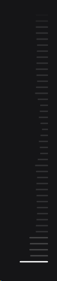
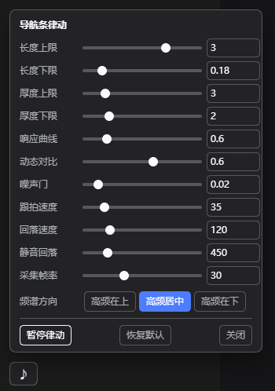

# dsh-pulse-rail

[English](README.md) | [中文](README.zh.md)

Turn the DeepSeek Harness **turn-navigation rail** into a music visualiser: every thin bar grows and
thickens with the system audio that is playing right now.



|  |  |
|---|---|
|  | A ♪ button sits right above the bottom-left user row. It opens a slider panel; every change is written back to `config.json` immediately — no restart. |

- **Windows, no admin, no drivers, no third-party runtime.** System audio is captured with WASAPI
  *shared-mode loopback* by a tiny self-contained helper (`lib/pulse-tap.exe`, built from
  `lib/pulse-tap.cs` with the in-box .NET Framework compiler).
- **Nothing but the bars change.** Bar length tracks its frequency band; bar thickness follows the
  beat. No glow, no colour, no shadow — pure geometry, and the whole thing is a compositor-only
  `transform: scale()`, so the right edge never jitters.
- **Native behaviour is untouched.** Hover previews, click-to-jump and wheel scrolling of the rail
  keep working exactly as before; with silence the bars return pixel-for-pixel to the stock look.

## Requirements

| | |
|---|---|
| DSH | desktop / web profile (`platform: web` client half) |
| OS | Windows 10/11 x64 (WASAPI loopback) |
| Runtime | none — `.NET Framework 4.x` csc is used only to *build* the helper |
| Audio | any default render device (headphones, USB DAC, HDMI, …) |

## Install

### A. Through the plugin manager (recommended)

1. **Settings → Plugins → Add plugin** and give this repository's URL (or a local path to a clone).
2. Enable it, then **restart DSH** (the host half is composed at boot).

> The manager refuses to install while an agent is running — do it from an idle session.

### B. From npm

Published as [`dsh-pulse-rail`](https://www.npmjs.com/package/dsh-pulse-rail):

```sh
dsh plugin add dsh-pulse-rail      # or: npm i dsh-pulse-rail
```

### C. Manual (what this plugin was developed with)

```bat
git clone https://github.com/<you>/dsh-pulse-rail.git
xcopy /E /I dsh-pulse-rail "%USERPROFILE%\.dsh\profiles\desktop\node_modules\dsh-pulse-rail"
```

Then add `"dsh-pulse-rail"` to `dsh.profile.bundles` in
`%USERPROFILE%\.dsh\profiles\desktop\package.json`:

```json
{
  "dsh": { "profile": { "bundles": [
    "@deepseek-ai/dsh-base", "@deepseek-ai/dsh-web-app", "dsh-pulse-rail"
  ] } }
}
```

and restart DSH. (Adding the package to `dependencies` as well makes it show up in the
installed-plugin list and protects it from `pnpm install` pruning.)

## Tuning

Everything lives in `%USERPROFILE%\.dsh\pulse-rail\config.json`. Edit it from the ♪ panel, or by
hand — then apply with the bundled helper:

```bat
%USERPROFILE%\.dsh\pulse-rail\tune-config.cmd
```

```jsonc
{
  "enabled": true,      // false = stop immediately, rail returns to stock
  "minW": 0.18,         // shortest bar, in units of the native 20px bar
  "maxW": 2.6,          // longest bar (panel slider goes up to 4 = 80px)
  "minH": 2,            // thinnest bar (px) — 2 is the app's native thickness
  "maxH": 7,            // thickest bar (px) — keep <= 8, marks are 10px apart
  "gamma": 0.6,         // response curve: <1 punchier, >1 calmer
  "gate": 0.02,         // noise floor: bands below this count as silence
  "agcMix": 0.6,        // dynamic contrast: compare each band with its own slow baseline
  "atkMs": 35,          // attack / release time constants of the bars
  "relMs": 120,
  "silentMs": 450,      // how long after the last audible frame the rail resets
  "freqLayout": "center",// "top" high frequencies on top | "center" both ends low | "down" highs at the bottom
  "fps": 30,            // capture frame rate
  "tapIdleMs": 20000    // stop the capture helper after this much idle time
}
```

Live apply without editing files (the port is the one in `DSH_WEB_URL`):

```powershell
Invoke-WebRequest -UseBasicParsing -Method POST -ContentType 'application/json' `
  -Body (Get-Content -Raw $env:USERPROFILE\.dsh\pulse-rail\config.json) `
  http://127.0.0.1:19387/pulse-rail/config
```

| Want | Turn |
|---|---|
| much more dramatic | `maxW` → 3–4, `agcMix` → 0.8–1.0 |
| calmer / less busy | `agcMix` → 0.3, `gate` → 0.05–0.1 |
| thicker pumping | `maxH` → 8 (max before the bars touch) |
| faster reaction | `atkMs` → 15–25 |

## How it works

```
default render device
   │  WASAPI shared-mode loopback (48 kHz, N-channel, float32)
   ▼
lib/pulse-tap.exe ── 1024-point FFT ──► 12 log-spaced bands (45 Hz – 15 kHz)
   │  one JSON line per frame on stdout, 30 fps
   ▼
host half (lib/index.js)  ──  GET /pulse-rail/state  ──►  browser half (lib/client.js)
                                    │                        │
                                    │                        └─ finds the rail, maps the 12 bands onto
                                    │                           however many marks are on screen right now
                                    └─ /pulse-rail/config, /pulse-rail/health, /pulse-rail/diag
```

* **Host half** (`lib/index.js` + `lib/tap.js`): lazily spawns the capture helper, keeps the last
  frame, serves it on same-origin routes. The helper is killed after 20 s without a request, is
  restarted with back-off if it dies, and self-terminates if the host stops heart-beating it.
* **Browser half** (`lib/client.js`): locates the rail by geometry (narrow column of small marks
  near the right edge, with a `button[data-index]` fallback), re-maps every frame to the *currently
  rendered* mark count, and writes one custom property per mark. Length and thickness are both
  expressed as `transform: scale()` on the mark's `::before`, with `transform-origin: 100% 50%`.
  Because the scroll container of the rail clips horizontally at 28 px, the plugin widens that
  container leftwards (right edge unchanged, hit area unchanged, `pointer-events` passed through)
  so long bars are actually visible.
* **Silence** removes every override — the rail is byte-for-byte the app's own rendering again.

## Privacy

The helper reads the system mix **in memory** and emits only band levels (12 floats) plus RMS/peak.
No audio is recorded, buffered or written to disk. It runs only while the page asks for data and
stops on its own 20 s after the last request; you can also watch it as `pulse-tap.exe` in Task
Manager, or set `"enabled": false`.

## Troubleshooting

| | |
|---|---|
| `GET /pulse-rail/health` | helper status: running / playing / pid / restarts / last error |
| `POST /pulse-rail/restart` | restart the capture helper |
| `GET /pulse-rail/diag` | last browser-side discovery reports |
| `%USERPROFILE%\.dsh\pulse-rail\diag.jsonl` | rolling client diag log (256 KB cap) |
| `%APPDATA%\@deepseek-ai\dsh-desktop\logs\crash-*-web-boot.log` | renderer `console.error` lines (e.g. `[dsh-pulse-rail] …`) |
| `lib\pulse-tap.exe --fps 30` | run the helper by hand and watch the JSON stream |

No sound in the bars? Play something and check `/pulse-rail/state` → `playing`. If `running` is
false, look at `lastError` (a USB/Bluetooth endpoint that reports all-zero samples is re-initialised
automatically after 5 s of silence).

## Development

| Tool | What it does |
|---|---|
| `tools/verify-install.mjs` | quickest sanity check: route registration + helper frames |
| `tools/harness.mjs` (+ `page.mjs`) | offline bench that replicates the rail DOM/CSS and reports every bar's measured geometry |
| `tools/host-test.mjs` | runs the real `lib/index.js` against a minimal `webServer` |
| `tools/cdp-check.mjs` | headless Edge + CDP: samples `::before` transforms, right-edge alignment and hit-testing |
| `tools/mktone.py`, `tools/mkmusic.py` | generate test tones / pseudo-music |

Rebuild the helper whenever `pulse-tap.cs` changes:

```bat
"C:\Windows\Microsoft.NET\Framework64\v4.0.30319\csc.exe" /nologo /platform:x64 /optimize+ ^
  /out:lib\pulse-tap.exe lib\pulse-tap.cs
```

## Uninstall

1. remove `"dsh-pulse-rail"` from `dsh.profile.bundles` (and from `dependencies`),
2. delete `node_modules\dsh-pulse-rail`,
3. optionally delete `%USERPROFILE%\.dsh\pulse-rail\`,
4. restart DSH.

## License

MIT — see [LICENSE](LICENSE).
